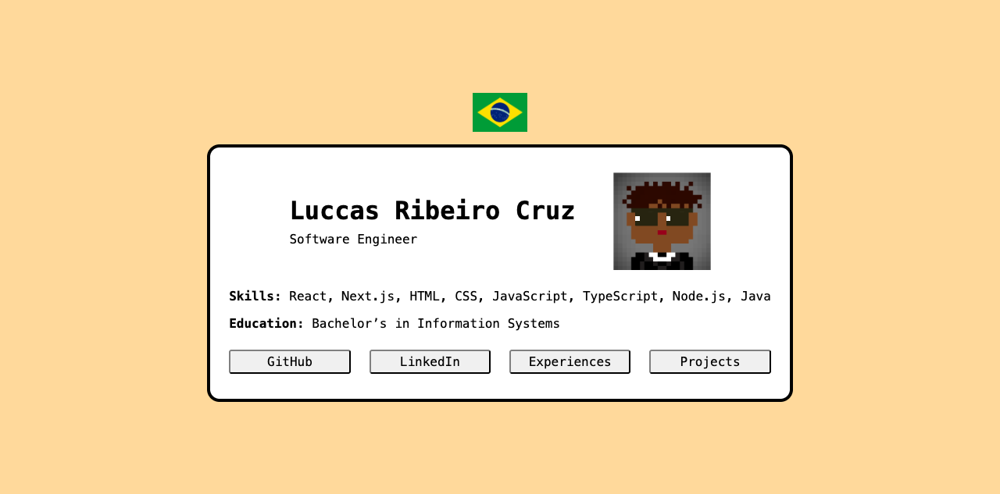
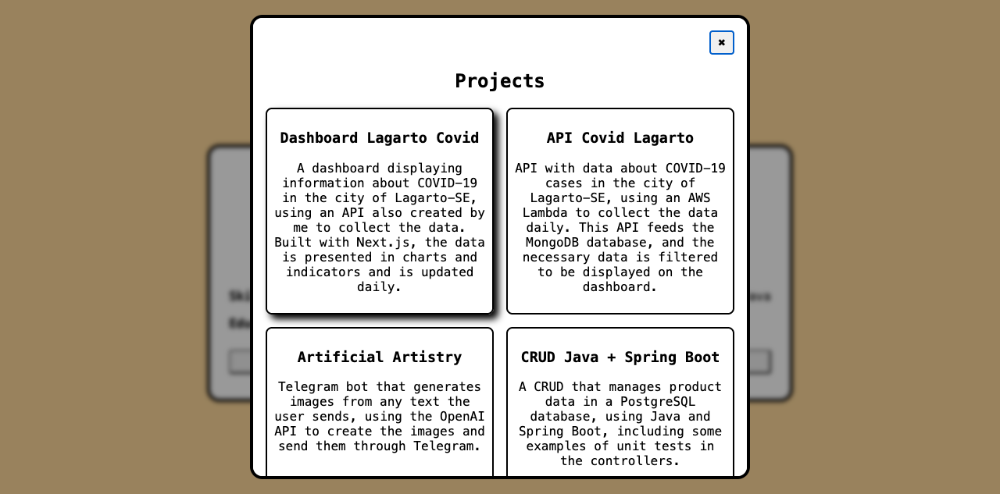
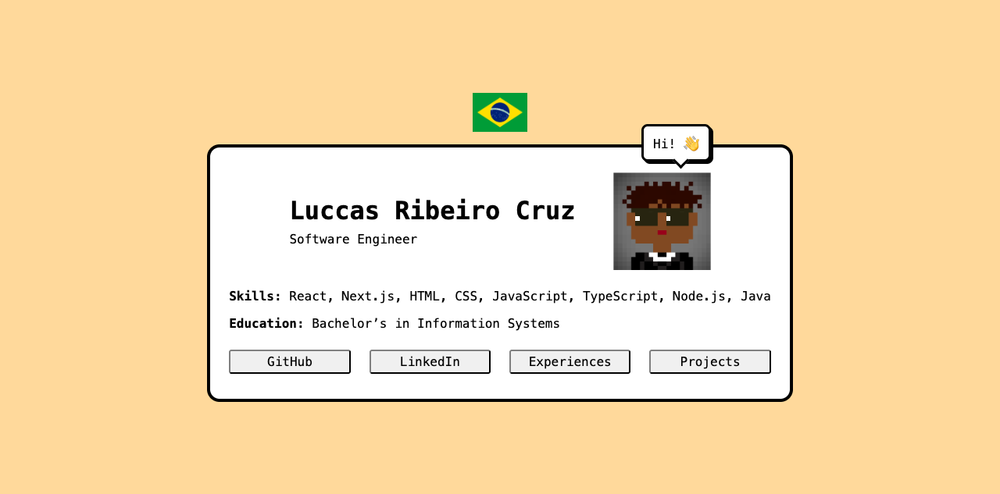

# Luccas Ribeiro Cruz — Portfólio

🇺🇸 [English](README.md) · 🇧🇷 **Português**

**🔗 No ar: [luccas-porfolio.vercel.app](https://luccas-porfolio.vercel.app/)**

Um portfólio minimalista, com estética retrô e uma versão minha em pixel art, feito só com HTML, CSS e JavaScript puros. Sem frameworks, sem dependências e sem etapa de build.



## Funcionalidades

- **Bilíngue (inglês / português):** clique na bandeira pra trocar o idioma. A página sai e volta como um elevador. Na primeira visita é usado o idioma do navegador, e a sua escolha fica salva.
- **Janelas de Experiências e Projetos:** um contorno sai do botão clicado e cresce até virar a janela, como nos sistemas operacionais antigos. Ao fechar, a janela encolhe de volta pro botão.
- **Animações acessíveis:** todas as animações são desligadas pra quem ativa *reduzir movimento* no sistema. As janelas fecham com Esc, com um clique fora ou pelo botão ✖.
- **Responsivo:** funciona no desktop, no tablet e no celular.



## Easter eggs

A página esconde algumas surpresas. Tente achar no [site](https://luccas-porfolio.vercel.app/) antes de abrir o spoiler.

<details>
<summary>🥚 Spoiler</summary>

<br>

- 🐴 A bandeira dá um saltinho de cavalinho a cada poucos segundos e balança quando o mouse passa por cima.
- 👀 Os olhos do pixel art seguem o mouse, pixel por pixel, dentro dos óculos escuros.
- 😉 De tempos em tempos ele pisca.
- 💬 Clique no pixel art e ele fala alguma coisa, com uma mensagem nova a cada clique.
- ⚽ Clique em qualquer lugar da página pra adicionar uma bola que quica nas bordas da tela, no card e na bandeira (até 50). Em português é uma bola de futebol, em inglês uma de futebol americano.
- 🧑‍💻 Abra o console do DevTools e o pixel art aparece desenhado lá, pixel por pixel.



</details>

## Tecnologias

| | |
|---|---|
| **Estrutura** | HTML5 com o elemento nativo `<dialog>` |
| **Estilos** | CSS3: Grid, Flexbox, animações com keyframes, `prefers-reduced-motion` |
| **Scripts** | JavaScript puro com a Web Animations API, mais um pequeno sistema de tradução feito do zero |
| **Deploy** | [Vercel](https://vercel.com/) |

## Rodando localmente

```bash
git clone https://github.com/luccascruuz/luccas-porfolio.git
cd luccas-porfolio
python3 -m http.server 8000
```

Depois abra [http://localhost:8000](http://localhost:8000).

> Abrir o `index.html` direto também funciona. A única coisa que falta é o pixel art no console, porque os navegadores bloqueiam a leitura dos pixels de imagens em páginas `file://`.

## Estrutura do projeto

```
├── index.html          # Conteúdo da página, escrito em inglês
├── docs/               # Screenshots usados neste README
└── src/
    ├── css/style.css   # Estilos e animações
    ├── js/index.js     # Traduções, troca de idioma, janelas e easter eggs
    └── image/          # Pixel art, favicon e bandeiras
```

### Adicionando ou editando uma tradução

O texto do `index.html` é escrito em inglês. Pra traduzir um elemento, dê a ele uma chave `data-i18n` e adicione o texto em português com a mesma chave no objeto `translations.pt`, em `src/js/index.js`:

```html
<p data-i18n="greeting">Hello!</p>
```

```js
const translations = {
    pt: {
        greeting: "Olá!",
    },
}
```

## Contato

- 💼 [LinkedIn](https://www.linkedin.com/in/luccas-ribeiro-cruz/)
- 🐙 [GitHub](https://github.com/luccascruuz)
